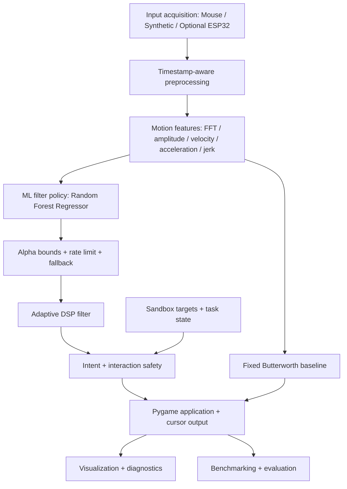

# IntentGlide — ML-Guided Adaptive Cursor Stabilization

**Project:** Adaptive cursor assistance for fine-motor accessibility  
**Track:** Human-Machine Interfaces (HMI)  
**Team size:** 4 members  
**Build window:** 24 hours  
**Core approach:** Classical DSP + ML-guided adaptive filtering + confidence-aware interaction

> **Less unwanted motion. More intentional control.**

IntentGlide is an engineering prototype that explores how adaptive signal processing and learned filter control can make pointer interaction more manageable for people experiencing tremor-related or other fine-motor difficulties.

The system analyses timestamped cursor movement, extracts movement characteristics, selects an appropriate smoothing strength, and filters the pointer trajectory. A separate intent controller can provide small, bounded target guidance only when one target is sufficiently likely. When target intent is ambiguous, the system abstains. Assistance must remain visible, reversible, and user-controlled.

> **Implementation status:** The current repository contains a Python/Pygame baseline, synthetic input, FFT-based motion analysis, a fixed Butterworth filter, a heuristic adaptive smoother, rule-based target scoring, tests, and starter ESP32 firmware. The trained ML filter controller in this plan is the next development stage; it is **not yet implemented or integrated** in the current application. Planned modules are identified as planned throughout this README.

---

## 1. Project goals

IntentGlide aims to:

1. Identify oscillatory components in pointer movement without claiming to diagnose a medical condition.
2. Preserve intentional cursor movement while reducing unwanted high-frequency motion.
3. Learn a suitable filtering strength from movement features instead of relying only on a manually defined rule.
4. Keep signal analysis, filter selection, cursor filtering, target assistance, and safety logic as separate components.
5. Evaluate improvements against fixed and rule-based baselines using repeatable tasks and measurable outcomes.
6. Remain runnable without physical hardware or a trained model by retaining synthetic input and a deterministic fallback.

A smoother cursor is not automatically a better cursor. Excessive smoothing can increase lag, suppress intentional rapid movement, and reduce task performance. We must measure both unwanted-motion reduction and preservation of intended movement.

## 2. Current implementation vs planned work

This section is the source of truth for implementation status.

### Already present in the repository

- Python application launched through Pygame.
- Synthetic cursor trajectory generator with configurable sinusoidal disturbance.
- Pygame mouse-event adapter that emits timestamped mouse samples.
- Motion analysis with timestamp resampling, detrending, a Hann window, FFT, and power analysis in a 4–12 Hz engineering test band.
- Second-order Butterworth low-pass baseline.
- Rule-based adaptive exponential smoothing with bounded alpha and rate-limited changes.
- Target ranking based on proximity and movement-direction alignment.
- Confidence threshold, ambiguity-margin logic, bounded directional assistance, and manual-override helper.
- Pygame sandbox, target-layout generation, and task scaffolding.
- ESP32 starter firmware for an ERM vibration motor.
- CSV benchmark logger, basic metrics, and unit/integration tests.

### Not yet implemented or not fully integrated

- ML training dataset and optimal-alpha label generation.
- Random Forest regression training and validated model artifact.
- Runtime loading and inference of a trained ML filter policy.
- ML-vs-heuristic-vs-fixed-filter evaluation on held-out scenarios.
- Expanded, fully documented X/Y feature extraction.
- A complete Python-to-ESP32 serial integration.
- A live-mouse path connected to the main app loop.

The current `MotionAnalyzer` estimates its frequency-domain signal using the X coordinate; do not describe it as complete two-dimensional tremor estimation until X and Y analysis is implemented and tested. The current main application uses synthetic input. The mouse adapter exists, but is not yet wired into the primary demo loop. The hardware sketch is starter firmware, not a complete host-to-device integration.

Real mouse events are not guaranteed to arrive at 120 Hz. Preserve actual timestamps and explicitly resample to a uniform grid where an algorithm requires uniform sampling. The current Butterworth baseline assumes a uniform 120 Hz analysis stream.

## 3. Proposed system architecture

The proposed architecture separates movement measurement, filter selection, filtering, and interaction assistance.



### Processing order

1. **Input — Person 1:** produce timestamped pointer samples and scenario/ground-truth metadata.
2. **Feature extraction — Person 2:** preprocess samples and calculate documented motion features.
3. **ML filter policy — Person 3:** predict a suitable target alpha from the feature vector.
4. **DSP filtering — Person 2:** apply the target alpha through a stateful filter, with bounds and rate limiting.
5. **Intent and safety — Person 4:** evaluate targets, apply bounded guidance only when justified, and abstain when intent is ambiguous.
6. **Application and evaluation — Person 4:** render the sandbox, expose diagnostics, and record outcomes.

The ML model does **not** directly move the cursor. It recommends the filter parameter; the DSP filter performs the actual signal transformation. Target-intent scoring is a separate rule-based component in the first ML version.

### Controlled signal model

For synthetic experiments, a disturbed cursor coordinate can be modelled as:

\[
x_{observed}(t) = x_{intended}(t) + d(t) + \epsilon(t)
\]

where `x_intended` is the known intended trajectory, `d(t)` is an imposed oscillatory disturbance, and `epsilon(t)` is additional noise. The existing generator uses a configurable 4–12 Hz disturbance range for engineering tests. This is not a clinical definition of tremor. The ERM vibration rig produces a controlled physical disturbance, not a clinically accurate model of a condition.

## 4. ML-guided adaptive filtering

### Why add machine learning?

The current adaptive filter uses a manually defined relationship between oscillation score and alpha. This is a useful baseline, but it can confuse different movement contexts. A deliberate fast movement and an intended smooth movement contaminated by oscillation can both contain high-frequency components. A single hand-written rule may smooth both too strongly or too weakly.

The proposed model learns how motion features relate to a suitable filtering strength. It does **not** replace the DSP filter. The model recommends a parameter; the DSP engine applies it.

### Initial model: Random Forest Regression

Start with `sklearn.ensemble.RandomForestRegressor`.

- The initial inputs are structured numerical features.
- It can learn nonlinear relationships without a large neural network.
- It is relatively quick to train and evaluate.
- Feature importance can help inspect which inputs influence predictions.
- It gives us a sensible baseline before exploring temporal deep-learning models.

Possible future models include XGBoost, a 1D CNN, or a GRU/LSTM only if experiments show that engineered window-level features are insufficient.

### What the model predicts

The first ML milestone is regression of the adaptive smoothing parameter:

\[
\alpha_{target} = f(\mathbf{z})
\]

where `z` is a feature vector calculated from a recent cursor-movement window.

The existing exponential smoother uses:

\[
\mathbf{p}_{f}[n] = \mathbf{p}_{f}[n-1] + \alpha(\mathbf{p}_{in}[n]-\mathbf{p}_{f}[n-1])
\]

- Lower alpha means stronger smoothing and potentially more lag.
- Higher alpha means greater responsiveness and potentially more residual jitter.
- Start with the existing bounds, `0.12 <= alpha <= 0.85`, unless controlled experiments justify changing them.
- Rate-limit alpha changes to avoid abrupt cursor behaviour.

The model is a **filter-policy regressor**, not a medical tremor classifier and not a predictor of future tremor events.

### Candidate input features

| Feature | Purpose |
|---|---|
| X/Y spectral power | Measure oscillatory energy separately by axis |
| Dominant frequency | Identify the strongest component in the selected frequency band |
| Estimated oscillation amplitude | Estimate the magnitude of periodic movement |
| Oscillation-band energy ratio | Compare energy in the test band with total non-zero-frequency energy |
| Periodicity confidence | Estimate how concentrated the strongest spectral peak is |
| Velocity | Describe cursor movement speed |
| Acceleration | Describe changes in movement speed and direction |
| Jerk | Describe rapid changes in acceleration |
| Directional consistency | Describe how consistently movement follows one direction |
| Spectral entropy | Describe how concentrated or spread out spectral energy is |
| Optional task context | Supply controlled interaction context without leaking target labels |

Person 2 must define the feature names, units, window length, normalization, missing-value handling, and exact feature order. Training and runtime must use the same schema.

### Training labels: estimate an optimal alpha

Person 1 generates synthetic scenarios with known intended paths. Person 3 uses those traces to construct supervised training examples.

For each training example:

1. Use only the past/current movement window to calculate the model input features.
2. For offline label generation, evaluate candidate alpha values with the same causal, stateful exponential filter over a defined subsequent evaluation horizon.
3. Compare each candidate's filtered output with the known intended path.
4. Measure tracking error, residual unwanted high-frequency motion, and lag.
5. Select the alpha with the lowest pre-agreed combined objective.

A starting objective is:

\[
J(\alpha)=w_eE_{tracking}(\alpha)+w_jE_{jitter}(\alpha)+w_lE_{lag}(\alpha)
\]

\[
\alpha^*=\underset{\alpha\in[0.12,0.85]}{\operatorname{argmin}}J(\alpha)
\]

The weights, normalization, candidate-alpha grid, filter initialization, warm-up period, and evaluation horizon must be documented and fixed before final test evaluation. Do not optimize only for smoothness: a cursor that barely moves could otherwise appear artificially good. Penalize tracking error and lag as well as residual jitter.

The model input must not contain future samples from the label horizon. Future samples may be used only offline to derive the training target alpha; this mirrors a policy learning what alpha would have worked best after observing the past window.

### Dataset strategy and generalization

Synthetic data is a good first step because the intended trajectory is known. Vary:

- Disturbance frequency, amplitude, axis, phase, and noise.
- Intended movement speed, direction, curvature, and trajectory shape.
- Smooth movement, fast movement, starts, stops, pauses, reversals, and corrective movement.
- Target size, spacing, and ambiguous-target layouts.
- Sample timing irregularity and input source.

Split by complete trajectories, scenario IDs, or generation seeds. Do not randomly split adjacent overlapping windows from the same trace across train and test; that can produce misleadingly high scores through leakage. Keep a final held-out test set untouched until model and objective choices are frozen.

Synthetic data supports controlled engineering evaluation, but does not establish real-world clinical or accessibility performance. Any later real-user validation requires appropriately consented data and a separate evaluation protocol.

### Runtime safeguards and fallback

The runtime ML policy must:

- Validate that all expected features are present and finite.
- Use the exact feature schema and preprocessing used during training.
- Clamp alpha to the allowed range and rate-limit changes.
- Expose whether the active policy is `ml` or `heuristic_fallback`.
- Fall back to the existing rule-based alpha policy if the model artifact is missing, malformed, or inference fails.
- Log model/policy version and inference time.
- Avoid claiming calibrated model confidence unless a suitable uncertainty method has been implemented and validated.

## 5. Four-person work distribution

The project is split into four independently testable workstreams. Person 1 takes responsibility for target layouts and sandbox task definitions to balance the work. Person 4 retains Pygame rendering and integration. File ownership is explicit to minimize merge conflicts.

### Person 1 — Input, Hardware, Data Generation & Sandbox Scenarios

**Goal:** Provide reliable input streams and repeatable scenarios with known intended trajectories.

**Responsibilities**

1. Implement synthetic input with configurable intended paths.
2. Add disturbance profiles with configurable frequency, amplitude, axis, phase, and noise.
3. Capture real Pygame mouse events while preserving actual timestamps.
4. Build/test the optional ESP32 + ERM vibration rig using an appropriate motor driver.
5. Generate ground-truth intended trajectories and scenario metadata for training/evaluation.
6. Own target geometry and target-layout generation.
7. Own task/scenario definitions: standard targets, small targets, closely spaced targets, and ambiguous-target layouts.
8. Keep input and scenario generation usable without physical hardware.

**Owns:** `input/`, `hardware/`, `sandbox/targets.py`, `sandbox/tasks.py`, input/scenario tests.

**Deliverables:** `input/input_provider.py`, `input/synthetic_generator.py`, planned `input/disturbance_profiles.py`, `hardware/esp32_controller.ino`, `sandbox/targets.py`, `sandbox/tasks.py`, `tests/test_input.py`, planned `tests/test_scenarios.py`.

**Handoff:** timestamped `InputSample` objects, target geometry, task configuration, and ground-truth scenario metadata.

**Boundary:** Person 1 owns target definitions and task logic, not Pygame rendering or the main application event loop. Person 4 owns `sandbox/scene.py`.

### Person 2 — DSP & Feature Engineering

**Goal:** Convert timestamped cursor movement into reliable motion features and filtered trajectories.

**Responsibilities**

1. Handle sample timing and preprocessing; do not assume real mouse events arrive at fixed 120 Hz.
2. Expand motion analysis to use both X and Y movement.
3. Calculate frequency-domain features, oscillation energy, dominant frequency, periodicity, and estimated amplitude.
4. Calculate velocity, acceleration, jerk, directional consistency, and spectral features.
5. Maintain the fixed second-order Butterworth baseline.
6. Maintain the rule-based adaptive exponential filter as the baseline/fallback.
7. Publish a stable, documented feature interface for Person 3.
8. Test feature behaviour, filter state, edge cases, and latency.

**Owns:** `dsp/` and DSP tests.

**Deliverables:** existing `dsp/motion_analyzer.py`, planned `dsp/feature_extractor.py` (or keep it inside `motion_analyzer.py` if a separate file adds no value), `dsp/fixed_filter.py`, `dsp/adaptive_filter.py`, and `tests/test_dsp.py`.

**Handoff:** a documented feature vector and filter outputs.

**Boundary:** Person 2 owns feature calculations and DSP filters, but does not train or serialize the ML model.

### Person 3 — ML & Adaptive Intelligence

**Goal:** Train and deploy the model that recommends an appropriate filter strength.

**Responsibilities**

1. Agree on the feature schema with Person 2 before dataset generation.
2. Load scenario traces generated by Person 1.
3. Prepare training windows and generate optimal-alpha labels using the agreed objective.
4. Train a Random Forest Regressor.
5. Evaluate on held-out trajectories and scenarios.
6. Compare ML predictions with the existing rule-based alpha policy.
7. Save/load the trained model using joblib.
8. Implement a small runtime interface such as `predict_alpha(features)`.
9. Add validation, bounds, rate limiting, policy-version information, and heuristic fallback.
10. Document limitations; do not present synthetic-only results as real-user validation.

**Owns:** `ml/`, ML dataset/model-pipeline code, ML tests, and the preparation of data under `data/processed/`.

**Deliverables:** planned `ml/dataset.py`, `ml/train.py`, `ml/filter_policy.py`, `ml/evaluate.py`, `ml/artifacts/` (local model artifacts), and `tests/test_ml.py`.

**Handoff:** a tested model artifact and a documented inference function returning a bounded alpha value plus the active policy source.

**Boundary:** Person 3 consumes feature definitions from Person 2 and scenario data from Person 1. Person 3 does not own the DSP implementation, target/task generation, or app orchestration.

### Person 4 — Application, Interaction, Integration & Evaluation

**Goal:** Keep a runnable application available throughout development and integrate the workstreams.

**Responsibilities**

1. Own the Pygame application shell and main event loop.
2. Own `sandbox/scene.py`, including rendering target layouts supplied by Person 1.
3. Build orchestration connecting input, features, ML policy, DSP filter, and interaction logic.
4. Maintain raw, fixed, heuristic-adaptive, ML-adaptive, and full-system comparison modes as they become available.
5. Own target ranking, intent confidence, ambiguity detection, bounded assistance, and manual-override integration.
6. Render raw/filtered trajectories, features, active alpha, policy source, target confidence, and controller state.
7. Build benchmark logging and evaluation dashboards.
8. Create mocks so the application runs before other modules are finished.
9. Integrate modules one at a time and run regression tests after each merge.
10. Coordinate demo flow, presentation, and feature freeze.

**Owns:** `app/`, `sandbox/scene.py`, `interaction/`, `visualization/`, `evaluation/`, and integration tests.

**Deliverables:** existing/planned `app/main.py`, `app/orchestrator.py`, `sandbox/scene.py`, `interaction/target_analyzer.py`, `interaction/intent_controller.py`, `interaction/assistance.py`, `interaction/interaction_safety.py`, `visualization/`, `evaluation/`, and `tests/test_integration.py`.

**Boundary:** Person 4 owns rendering and integration, not target-layout generation, feature extraction, or ML training.

### Ownership summary

| Work area | Owner | Handoff |
|---|---|---|
| `input/`, `hardware/` | P1 | Timestamped samples and disturbance scenarios |
| `sandbox/targets.py`, `sandbox/tasks.py` | P1 | Target geometry and task configuration |
| `dsp/` | P2 | Documented feature vectors and filtered coordinates |
| `ml/`, processed training data | P3 | Predicted alpha and model diagnostics |
| `app/`, `sandbox/scene.py` | P4 | Integrated interactive application |
| `interaction/` | P4 | Intent decisions and safe assistance |
| `visualization/`, `evaluation/` | P4 | Diagnostics and benchmark results |
| `shared/`, shared contracts | All | Stable interfaces and mocks |

## 6. Target GitHub folder structure

This is the intended structure after the ML workstream is added. Items marked **NEW / PLANNED** are not necessarily present in the current repository yet. Existing files should be retained unless the team deliberately refactors them.

```text
IntentGlide/
├── README.md
├── START_HERE.md
├── MANIFEST.txt
├── requirements.txt
├── .gitignore
│
├── app/                              # P4: application and orchestration
│   ├── __init__.py
│   ├── main.py
│   └── orchestrator.py
│
├── input/                            # P1: input and scenario data
│   ├── __init__.py
│   ├── input_provider.py
│   ├── synthetic_generator.py
│   └── disturbance_profiles.py       # NEW / PLANNED
│
├── hardware/                         # P1: optional physical disturbance rig
│   └── esp32_controller.ino
│
├── sandbox/                          # P1 scenario data; P4 rendering
│   ├── __init__.py
│   ├── targets.py                    # P1: target geometry and layouts
│   ├── tasks.py                      # P1: task/scenario definitions
│   └── scene.py                      # P4: Pygame rendering
│
├── dsp/                              # P2: preprocessing and signal processing
│   ├── __init__.py
│   ├── motion_analyzer.py
│   ├── feature_extractor.py           # NEW / PLANNED (optional split)
│   ├── fixed_filter.py
│   └── adaptive_filter.py
│
├── ml/                               # P3: learned filter policy
│   ├── __init__.py                   # NEW / PLANNED
│   ├── README.md
│   ├── dataset.py                    # NEW / PLANNED
│   ├── train.py                      # NEW / PLANNED
│   ├── filter_policy.py              # NEW / PLANNED
│   ├── evaluate.py                   # NEW / PLANNED
│   └── artifacts/                    # local model files; normally ignored by Git
│
├── data/                             # P1 generates; P3 prepares
│   ├── README.md
│   ├── generated/                    # local synthetic traces; ignored by Git
│   └── processed/                    # local feature/label tables; ignored by Git
│
├── interaction/                      # P4: target intent and safety
│   ├── __init__.py
│   ├── target_analyzer.py
│   ├── intent_controller.py
│   ├── assistance.py
│   └── interaction_safety.py
│
├── visualization/                    # P4: visualization and diagnostics
│   ├── __init__.py
│   ├── cursor_canvas.py
│   ├── diagnostics.py
│   └── dashboard.py
│
├── evaluation/                       # P4: whole-system benchmarks
│   ├── __init__.py
│   ├── benchmark.py
│   ├── metrics.py
│   └── results/                      # generated results; avoid private data
│
├── shared/                           # ALL: shared interfaces and mocks
│   ├── __init__.py
│   ├── contracts.py
│   └── mocks.py
│
└── tests/                            # ALL: module and integration tests
    ├── __init__.py
    ├── test_input.py
    ├── test_scenarios.py             # NEW / PLANNED
    ├── test_dsp.py
    ├── test_ml.py                    # NEW / PLANNED
    ├── test_intent.py
    └── test_integration.py
```

**Sandbox ownership boundary:** Person 1 develops `targets.py` and `tasks.py` (what targets/scenarios exist); Person 4 develops `scene.py` (how those targets/scenarios are drawn and orchestrated). Person 1 should not duplicate the Pygame renderer or app event loop.

## 7. Shared interfaces and contracts

The current `shared/contracts.py` defines `InputSample`, `MotionFeatures`, `FilterOutput`, `Target`, and `IntentDecision`. All team members should use these shared data structures instead of creating incompatible versions. Extend them only after team agreement.

### Core existing contracts

```python
from dataclasses import dataclass
from typing import Literal, Optional

@dataclass
class InputSample:
    timestamp: float                  # monotonic seconds
    x: float                          # screen pixels
    y: float                          # screen pixels
    source: Literal["synthetic", "mouse", "hardware"]
    accel_x: Optional[float] = None
    accel_y: Optional[float] = None

@dataclass
class MotionFeatures:
    oscillation_score: float          # normalized 0.0–1.0
    dominant_frequency: Optional[float]
    periodicity_confidence: float     # normalized 0.0–1.0
    directional_consistency: float   # normalized 0.0–1.0
    velocity: float                   # pixels per second

@dataclass
class FilterOutput:
    x: float
    y: float
    alpha: Optional[float] = None
    mode: Literal["raw", "fixed", "adaptive"] = "adaptive"

@dataclass
class Target:
    id: str
    center_x: float
    center_y: float
    width: float
    height: float

@dataclass
class IntentDecision:
    state: Literal[
        "stable", "oscillation_detected", "target_confident",
        "target_ambiguous", "override"
    ]
    target_id: Optional[str]
    confidence: float                 # normalized 0.0–1.0
    assist_dx: float                  # bounded pixels
    assist_dy: float                  # bounded pixels
```

### Additional interfaces to agree before implementation

**P1 → P2/P4: input and scenario handoff**

- `InputSample`: timestamp, X/Y, source, optional sensor values.
- Scenario metadata: movement type, target layout, disturbance settings, sample rate, generation seed, and ground-truth reference.
- `Target` objects with stable IDs and geometry.

**P2 → P3: feature handoff**

- A named/documented feature vector.
- Feature names, units, window length, normalization, ordering, and timestamp assumptions.
- Explicit handling of missing/invalid values.

**P3 → P2/P4: ML policy handoff**

```python
alpha_target = filter_policy.predict_alpha(motion_features)
filtered = adaptive_filter.update(sample, alpha_target=alpha_target)
```

This is a proposed interface; the current adaptive filter still calculates alpha internally from `MotionFeatures`. Refactoring it to accept a model-provided target alpha is a planned integration task. The policy should expose whether the selected source is `ml` or `heuristic_fallback`.

### Contract rules

1. Coordinates are screen pixels.
2. Timestamps are monotonic seconds, not frame numbers.
3. Preserve real sample intervals. Do not assume mouse/ESP32 samples arrive at exactly 120 Hz.
4. Normalized scores use 0.0–1.0 and must document their calculation.
5. Missing sensor values are `None`, not fabricated readings.
6. Training and runtime feature order and preprocessing must match exactly.
7. Filter state persists across samples and is reset between independent trials.
8. Keep processing time separate from end-to-end latency.
9. Announce and review changes to shared contracts before merging.
10. Every module must run with mock inputs before integration.

## 8. Integration strategy

Keep a working end-to-end application throughout development. Integrate modules one at a time.

1. **Runnable shell:** Person 4 launches the Pygame app with mocks and a basic scene.
2. **Scenario source:** connect Person 1's synthetic generator, target layouts, and task scenarios.
3. **DSP baseline:** connect Person 2's feature extraction, fixed filter, and heuristic adaptive filter.
4. **ML policy:** connect Person 3's model behind `predict_alpha`; retain the heuristic fallback.
5. **Intent and safety:** connect target ranking, confidence, ambiguity abstention, bounded assistance, and override.
6. **Hardware:** connect the ESP32 source only after the synthetic pipeline is stable.
7. **Evaluation:** run identical scenarios in all comparison modes and record results.
8. **Feature freeze:** stop adding features; fix bugs, validate measurements, and rehearse.

After each integration, run module tests and integration tests. If a module is late or breaks the app, keep its mock/fallback in place while its owner fixes it.

## 9. Twenty-four-hour execution plan

| Time | Person 1 — Input / Hardware / Scenarios | Person 2 — DSP / Features | Person 3 — ML | Person 4 — App / Integration |
|---|---|---|---|---|
| 0–1 h | Agree input and scenario contracts | Agree feature definitions | Agree ML feature and label schema | Contracts, mocks, runnable app shell |
| 1–4 h | Synthetic generator, disturbance profiles, target layouts | FFT analysis and fixed filter baseline | Dataset and label-generation design | Pygame scene and mock pipeline |
| 4–7 h | Task scenarios, ground truth, mouse adapter | Adaptive filter and feature extraction | Implement alpha-label generation | Orchestrator and UI mode selection |
| 7–10 h | Optional ESP32 rig; provide sample data | Verify features and filter state | Train first Random Forest | Integrate input and DSP |
| 10–12 h | Input and scenario handoff | Feature/DSP handoff | Model inference handoff or fallback | Connect ML policy and interaction |
| 12–15 h | Test disturbances and scenarios | Tune/validate filter behaviour | Evaluate held-out scenarios | Complete end-to-end pipeline |
| 15–18 h | Hardware reliability and edge cases | Signal diagnostics and latency | Compare ML vs rule-based policy | Benchmark dashboard and demo flow |
| 18–20 h | Bug fixes | Bug fixes | Bug fixes / model freeze | Feature freeze and regression tests |
| 20–22 h | Demo support | Performance measurements | Final model measurements | Presentation and recording |
| 22–24 h | Final tests | Final tests | Final tests | Submission and pitch rehearsal |

### Parallel-work rule

- P1 can generate samples, targets, and tasks without waiting for DSP or the application.
- P2 can test features and filters using synthetic traces and mocks.
- P3 can build dataset and training code against a frozen feature schema before final DSP integration.
- P4 can build the application around mock input, features, filter outputs, and intent decisions.

## 10. Git workflow and collaboration rules

Suggested branches:

```text
main
├── person1/input-hardware-sandbox
├── person2/dsp-feature-engineering
├── person3/ml-filter-policy
└── person4/app-integration
```

Example:

```bash
git checkout main
git pull origin main
git checkout -b person1/input-hardware-sandbox

# Make a focused change in owned files
git add input/ hardware/ sandbox/targets.py sandbox/tasks.py
git commit -m "Add input and sandbox scenario support"
git push -u origin person1/input-hardware-sandbox
```

Team rules:

- Keep `main` runnable.
- Work primarily within assigned folders.
- Push small, reviewable commits regularly and open pull requests.
- Agree on shared contracts before dependent modules are integrated.
- Do not commit secrets, `.env` files, local environments, caches, or large generated datasets.
- Do not commit unvalidated trained model binaries by default. Track model version, training configuration, and metrics; use an agreed artifact-sharing method when needed.
- Keep dataset generation reproducible through scripts, configuration, and seeds.
- Coordinate changes to another person's owned files before editing.
- Person 4 integrates changes incrementally and runs regression tests after merges.
- A delayed module remains behind a mock or fallback; it must not block the rest of the application.

## 11. Demonstration plan

The demo should prove that IntentGlide balances stability and responsiveness, not merely that it makes a cursor smoother.

### Scenario A — Controlled oscillatory disturbance

1. Launch the sandbox with a standard target layout.
2. Generate a known intended path with a controlled disturbance, for example 8 Hz.
3. Display raw movement.
4. Compare fixed Butterworth, heuristic adaptive, and ML-adaptive outputs.
5. Display estimated features, selected alpha, active policy source, and processing time.
6. Compare trajectory error and residual oscillation with the known intended path.

### Scenario B — Intentional rapid movement

1. Generate a deliberate fast movement with little/no imposed disturbance.
2. Check whether the ML policy preserves responsiveness rather than unnecessarily smoothing the movement.
3. Compare completion time and tracking error against baselines.

### Scenario C — Ambiguous targets

1. Switch to a layout with two or more closely spaced targets.
2. Move the cursor so that competing target scores are similar.
3. Show that the intent controller abstains from directional guidance.
4. Demonstrate immediate manual override.

### Optional hardware demonstration

Repeat a controlled scenario with the ESP32 vibration rig if it is reliable. Hardware is an optional input source, not a core software dependency. Never drive an ERM motor directly from a microcontroller GPIO; use a suitable motor driver and power supply.

### Fallback demonstration

The synthetic scenario must demonstrate the full available software pipeline without physical hardware. If the ML model is not ready, show the rule-based fallback and label it clearly. Do not imply that the ML stage is active when it is not.

## 12. Evaluation plan

Compare these modes using identical intended paths, disturbance settings, target layouts, and trial conditions:

| Mode | Description | Status |
|---|---|---|
| A — Raw | No filtering or target guidance | Existing |
| B — Fixed | Butterworth low-pass filter | Existing |
| C — Rule-based adaptive | Current adaptive exponential filter | Existing |
| D — ML adaptive | ML-predicted alpha + adaptive exponential filter | Planned |
| E — Full system | ML adaptive filtering + confidence-aware assistance and safety | Planned |

### Metrics

| Metric | What it measures |
|---|---|
| Trajectory RMSE | Difference between output and known intended path |
| Residual high-frequency power | Remaining energy in the imposed oscillation band |
| Jitter reduction | Reduction in unwanted high-frequency movement |
| Lag / response delay | Tracking delay or loss introduced by filtering |
| Target acquisition success | Whether the intended target is reached |
| Wrong-target activations | Incorrect target selections |
| Task completion time | Time required to complete the task |
| False assistance rate | Cases where guidance activates unnecessarily |
| Abstention behaviour | Whether ambiguous cases receive no directional assistance |
| Processing time | Feature extraction, inference, filtering, and interaction computation time |
| End-to-end latency | Delay from input event to displayed cursor response |
| Alpha prediction error | Difference between predicted alpha and offline optimal-alpha label |

Report median and spread as well as averages where appropriate. Use repeated trials and held-out trajectories. Keep synthetic, hardware-generated, and real-user data results separate. Do not invent or overstate results.

### ML-specific evaluation

- Compare the Random Forest policy against the existing formula-based adaptive alpha policy.
- Use held-out complete trajectories/scenarios, not random adjacent overlapping windows.
- Report deliberate rapid movement and oscillatory movement separately.
- Test multiple frequencies, amplitudes, directions, speeds, and trajectory shapes.
- Record the chosen loss function and its weights.
- Measure inference latency on the actual development hardware.
- Treat synthetic-only generalization as preliminary.

## 13. Technology stack and setup

| Area | Technology | Purpose | Status |
|---|---|---|---|
| Main application | Python | Input, orchestration, DSP, ML, evaluation | Existing |
| Numerical computing | NumPy | Arrays, numerical operations, FFT | Existing |
| Signal processing | SciPy | Butterworth filter design and filtering | Existing |
| Interactive sandbox | Pygame | Cursor workspace, targets, diagnostics | Existing |
| ML | scikit-learn | Random Forest regression and evaluation | Planned |
| Model persistence | joblib | Saving/loading trained model | Planned |
| Embedded hardware | ESP32 + Arduino C/C++ | Optional vibration-rig control | Starter firmware exists |
| Testing | pytest | Unit and integration tests | Existing |
| Collaboration | Git + GitHub | Branches, reviews, integration | Existing |

Set up the environment:

```bash
python -m venv .venv

# Windows PowerShell
.venv\Scripts\Activate.ps1

# macOS / Linux
source .venv/bin/activate

pip install -r requirements.txt
```

Run the current app and tests:

```bash
python -m app.main
pytest -q
```

The ML training and inference commands will be documented once those modules are implemented. Do not assume `python -m ml.train` works before `ml/train.py` exists.

## 14. Priority order

| Priority | Feature |
|---|---|
| P0 — Must work | Synthetic input with known ground-truth trajectory |
| P0 — Must work | Runnable Pygame sandbox and target/task scenarios |
| P0 — Must work | Fixed and rule-based adaptive baselines |
| P0 — Must work | Shared feature interface and repeatable evaluation |
| P0 — Must work | Intent ambiguity abstention and manual override |
| P1 — Important | Dataset generation and optimal-alpha labels |
| P1 — Important | Random Forest training and inference |
| P1 — Important | ML vs rule-based adaptive comparison |
| P1 — Important | Benchmark dashboard and latency measurement |
| P1 — Important | ESP32 physical disturbance rig |
| P2 — Stretch | Accelerometer integration |
| P2 — Stretch | 1D CNN / GRU temporal model |
| P2 — Stretch | Per-user calibration and personalization |
| P2 — Stretch | Frequency-selective or narrowband cancellation |

If time runs short, deliver a solid DSP baseline, controlled synthetic scenarios, and honest measurements before attempting a more complex model.

## 15. Definition of done

### Core application

- [ ] App launches with one command.
- [ ] Synthetic input works without hardware.
- [ ] Standard and ambiguous target layouts work.
- [ ] Raw, fixed, and rule-based adaptive modes work.
- [ ] Motion features and diagnostics are visible.
- [ ] Manual override works immediately.
- [ ] Ambiguous intent causes the controller to abstain.
- [ ] Tests pass and the demo is repeatable.

### ML extension

- [ ] Feature schema is frozen and shared by training and inference.
- [ ] Training data includes deliberate rapid movement as well as imposed oscillations.
- [ ] Optimal-alpha labels use a documented tracking/jitter/lag objective.
- [ ] Train/validation/test split is made by complete trajectories or scenarios.
- [ ] Random Forest is trained and evaluated.
- [ ] ML-adaptive mode is compared against the rule-based adaptive baseline.
- [ ] Predicted alpha is finite, bounded, and rate-limited.
- [ ] Missing or invalid model falls back safely.
- [ ] Model and dataset versions are recorded.

### Hardware and evaluation

- [ ] ESP32 rig is optional and electrically safe.
- [ ] Synthetic and physical data are identified separately.
- [ ] Processing time and end-to-end latency are measured separately.
- [ ] No simulated result is presented as a real-user result.
- [ ] Final demo and fallback recording are ready.

## 16. Technical and safety notes

IntentGlide is an engineering prototype, not a medical diagnostic device or a clinically validated intervention. It must not diagnose Parkinson's disease or infer a user's medical condition from cursor movement.

The synthetic generator and ERM vibration rig create controlled disturbances for engineering evaluation. They do not reproduce the full physiology, variability, or lived experience of a tremor condition.

Assistance should remain visible, bounded, reversible, and user-controlled. When intent is uncertain, the system should abstain rather than guess. Filtering should not prevent intentional rapid movement or user override. Future real-user data collection must be consented, privacy-aware, and reviewed under relevant institutional requirements.

## 17. Final team principle

**Every module works independently. Every module follows a shared contract. The complete application remains runnable throughout development.**

- **Person 1:** input generation, hardware, target geometry, and task scenarios.
- **Person 2:** DSP and feature engineering.
- **Person 3:** ML dataset preparation, training, and filter-policy inference.
- **Person 4:** Pygame rendering, intent/safety integration, orchestration, and end-to-end evaluation.
- **Everyone:** shared contracts, tests, documentation, and demo readiness.

The strongest result is not the most complicated model. It is a measured, explainable system that reduces unwanted motion without sacrificing the user's intentional control.
