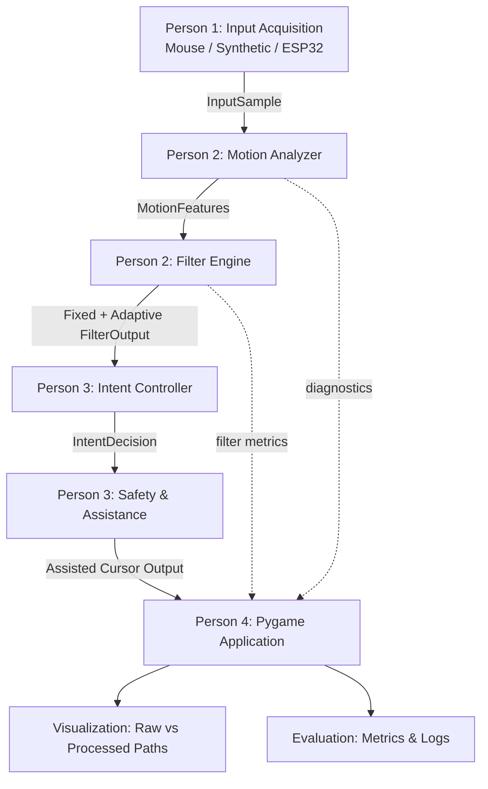

# IntentGlide — Team Workflow & Development Plan

**Adaptive Cursor Assistance for Fine-Motor Accessibility**  
**Hackathon track:** Human-Machine Interfaces (HMI)  
**Build window:** 24 hours  
**Team size:** 4 members

> **Less unwanted motion. More intentional control.**

IntentGlide is a prototype HMI system that explores how adaptive signal processing and confidence-aware target assistance can make pointer interaction more manageable for people experiencing tremor-related or other fine-motor difficulties.

The project analyses timestamped pointer movement, estimates tremor-like oscillatory components, adjusts cursor smoothing, and provides bounded target guidance only when the likely target is sufficiently clear. When intent is ambiguous, the system abstains from directional assistance. The user can always disable assistance.

This README defines the team split, module boundaries, shared interfaces, repository structure, integration plan, timeline, and demo scenario for a coordinated 24-hour build.

---

## 1. Team structure and ownership

The project is divided into four independently testable modules. **Person 4 is the integration owner** and must keep a runnable application available from the first hour using mocked versions of the other modules.

| Member | Module | Primary responsibility | Owns |
|---|---|---|---|
| **Person 1** | Input acquisition & hardware | Mouse events, synthetic disturbances, ESP32 vibration rig | `input/`, `hardware/` |
| **Person 2** | Signal processing & adaptive filtering | Motion analysis, Butterworth baseline, adaptive smoothing | `dsp/` |
| **Person 3** | Intent recognition & safety | Target confidence, bounded guidance, abstention, click safety | `interaction/` |
| **Person 4** | Application, orchestration & evaluation | Pygame interface, integration, visualization, benchmark dashboard | `app/`, `visualization/`, `evaluation/` |

### Person 1 — Input Acquisition & Hardware

**Goal:** Provide reliable timestamped pointer samples and repeatable disturbance inputs to the DSP engine.

Tasks:

1. Build a synthetic input generator that creates an intended cursor trajectory with a configurable oscillatory disturbance.
2. Support a configurable disturbance frequency in the 4–12 Hz test range and adjustable amplitude.
3. Capture real mouse movement through Pygame mouse events, preserving timestamps and actual sample intervals.
4. Build the ESP32 motor-control circuit using an ERM vibration motor and a suitable MOSFET driver.
5. Mount the motor securely to the mouse chassis and verify its vibration frequency with an optional accelerometer, where available.
6. Provide a switch between synthetic input and the physical-hardware demonstration source.
7. Ensure the synthetic generator works independently of the physical hardware.

**Deliverables:**

- `input/input_provider.py`
- `input/synthetic_generator.py`
- `hardware/esp32_controller.ino`
- `tests/test_input.py`

**Handoff:** A stream of `InputSample` objects.

**Definition of done:** Person 2 can run the input generator independently and receive valid coordinates, timestamps, source information, and optional sensor readings without requiring the physical rig.

**Important:** Do not assume Pygame mouse events arrive at exactly 120 Hz. Preserve event timestamps and calculate using actual sample intervals. The synthetic generator may use a controlled 120 Hz sample clock for repeatable DSP tests.

### Person 2 — Signal Processing & Adaptive Filtering

**Goal:** Build the signal-processing engine that estimates motion characteristics and produces fixed and adaptive cursor outputs.

Tasks:

1. Implement a motion analyzer that calculates cursor velocity, high-frequency oscillation energy, periodicity confidence, directional consistency, and a normalized oscillation score.
2. Implement a stateful second-order Butterworth low-pass filter as the fixed-filter baseline. Use a nominal 3 Hz cutoff at a 120 Hz analysis rate for the initial comparison.
3. Implement adaptive exponential smoothing:

   ```python
   filtered_position = previous_filtered_position + alpha * (
       current_input_position - previous_filtered_position
   )
   ```

4. Adjust `alpha` within predefined bounds using motion features and controller context. Smaller `alpha` means stronger smoothing and potentially more lag; larger `alpha` means more responsive movement.
5. Smooth parameter changes to avoid abrupt cursor behavior.
6. Preserve the filter's internal state across samples.
7. Return diagnostics including filter strength, oscillation score, dominant-frequency estimate, and processing time.

**Deliverables:**

- `dsp/motion_analyzer.py`
- `dsp/fixed_filter.py`
- `dsp/adaptive_filter.py`
- `tests/test_dsp.py`

**Handoff:** `MotionFeatures` and `FilterOutput` objects for fixed and adaptive modes.

**Definition of done:** Given the same input sequence, both filter implementations consistently produce valid output trajectories and can run independently of the UI and ESP32.

### Person 3 — Intent Recognition & Interaction Safety

**Goal:** Decide when the system should provide bounded assistance and when it should refrain from intervening.

Tasks:

1. Maintain a list of candidate targets and their coordinates and dimensions.
2. Calculate cursor-to-target distance.
3. Calculate directional alignment between current movement and each candidate target.
4. Evaluate target ambiguity when multiple targets are similarly plausible.
5. Produce target-confidence values using distance, directional alignment, and target uniqueness.
6. Apply small, bounded directional guidance only when assistance is justified and confidence is sufficiently high.
7. Implement the controller states below.
8. Add immediate manual override, cancellation when the user moves away, visible assistance state, and optional uncertain-click protection.
9. Test clear-target, ambiguous-target, movement-away, high-speed intentional movement, and override cases.

**Controller states:**

| State | Expected behavior |
|---|---|
| `stable` | Normal filtered cursor movement; no target guidance |
| `oscillation_detected` | Use the selected filtering mode; expose motion diagnostics |
| `target_confident` | Apply bounded directional guidance to the leading target |
| `target_ambiguous` | Abstain from directional guidance; leave the user in control |
| `override` | Disable assistance immediately and return to direct filtered or raw control, according to the selected mode |

**Deliverables:**

- `interaction/target_analyzer.py`
- `interaction/intent_controller.py`
- `interaction/assistance.py`
- `interaction/interaction_safety.py`
- `tests/test_intent.py`

**Handoff:** An `IntentDecision` containing controller state, candidate target, confidence, and bounded assistance offset.

**Definition of done:** The controller assists when one target is sufficiently clear, abstains when targets are ambiguous, and always respects manual override.

### Person 4 — Application, Orchestration & Benchmarking

**Goal:** Keep the full application running from hour one and integrate each module incrementally.

Tasks:

1. Create the Pygame application shell with a cursor canvas, different-sized targets, mode selector, diagnostics panel, and controls.
2. Create mock implementations of input, DSP, and intent modules so the complete application can run before teammates finish their code.
3. Implement the orchestration loop that calls the modules in the agreed order.
4. Build the four comparison modes: raw, fixed filter, adaptive filter, and full system.
5. Render raw and processed trajectories, controller state, candidate target, and assistance indicators.
6. Implement benchmark logging and metrics.
7. Replace mocks with real modules one at a time, testing the full application after each replacement.
8. Keep `main` runnable and coordinate merges.

**Deliverables:**

- `app/main.py`
- `app/orchestrator.py`
- `visualization/cursor_canvas.py`
- `visualization/diagnostics.py`
- `visualization/dashboard.py`
- `evaluation/benchmark.py`
- `evaluation/metrics.py`
- `tests/test_integration.py`

**Definition of done:** The app launches with one command, supports all four modes, displays live diagnostics, and completes the primary demo from start to finish.

---

## 2. System architecture and data flow



### Processing order

1. Person 1 produces a timestamped `InputSample`.
2. Person 2 updates motion features and generates fixed/adaptive filtered positions.
3. Person 3 evaluates candidate targets and determines whether to assist or abstain.
4. Person 3's safety layer applies bounded guidance or passes through the filtered position unchanged.
5. Person 4 renders the raw and output paths, controller state, and metrics.
6. The evaluation module records the sample and outcomes.

**Integration owner:** Person 4 owns the orchestration layer. Other members should expose simple functions/classes that accept and return the shared data structures. Avoid cross-importing internal implementation details between teammates.

---

## 3. Shared interfaces — agree these before coding

Create `shared/contracts.py`. All members must import these definitions rather than independently creating similar structures.

```python
from dataclasses import dataclass
from typing import Literal, Optional


@dataclass
class InputSample:
    timestamp: float                  # monotonic seconds
    x: float                           # screen pixels
    y: float                           # screen pixels
    source: Literal["synthetic", "mouse", "hardware"]
    accel_x: Optional[float] = None
    accel_y: Optional[float] = None


@dataclass
class MotionFeatures:
    oscillation_score: float           # normalized 0.0–1.0
    dominant_frequency: Optional[float]
    periodicity_confidence: float      # normalized 0.0–1.0
    directional_consistency: float    # normalized 0.0–1.0
    velocity: float                    # pixels per second


@dataclass
class FilterOutput:
    x: float
    y: float
    alpha: Optional[float] = None
    mode: Literal["raw", "fixed", "adaptive"] = "adaptive"


@dataclass
class Target:
    id: str
    center_x: float
    center_y: float
    width: float
    height: float


@dataclass
class IntentDecision:
    state: Literal[
        "stable",
        "oscillation_detected",
        "target_confident",
        "target_ambiguous",
        "override",
    ]
    target_id: Optional[str]
    confidence: float                  # normalized 0.0–1.0
    assist_dx: float                   # bounded offset in pixels
    assist_dy: float                   # bounded offset in pixels
```

### Contract rules

1. Coordinates are screen pixels.
2. Timestamps are monotonic seconds.
3. Normalized scores/confidence use the range `0.0–1.0`.
4. Missing optional sensor values must be `None`, not invented readings.
5. Each module must return the agreed structure, including field names and types.
6. Any contract change must be announced and approved by the whole team before editing `shared/contracts.py`.
7. Do not use `InputSample.timestamp` as a frame number. Use elapsed time when calculating velocity and derivatives.
8. Keep processing time and end-to-end cursor latency as separate metrics.

### Mocks

Create `shared/mocks.py` containing:

- A sample input sequence.
- A sample `MotionFeatures` instance.
- Fixed and adaptive `FilterOutput` examples.
- One clear-target `IntentDecision`.
- One ambiguous-target `IntentDecision`.

Person 4 uses these mocks to build the full application first. Persons 2 and 3 use them to test their modules independently.

**Golden rule:** Every module must work with mock data before integration with another person's real implementation.

---

## 4. Repository structure

```text
intentglide/
├── README.md
├── requirements.txt
├── app/                         # Person 4
│   ├── main.py
│   └── orchestrator.py
├── input/                       # Person 1
│   ├── input_provider.py
│   └── synthetic_generator.py
├── hardware/                    # Person 1
│   └── esp32_controller.ino
├── dsp/                         # Person 2
│   ├── motion_analyzer.py
│   ├── fixed_filter.py
│   └── adaptive_filter.py
├── interaction/                 # Person 3
│   ├── target_analyzer.py
│   ├── intent_controller.py
│   ├── assistance.py
│   └── interaction_safety.py
├── visualization/                # Person 4
│   ├── cursor_canvas.py
│   ├── diagnostics.py
│   └── dashboard.py
├── evaluation/                  # Person 4
│   ├── benchmark.py
│   └── metrics.py
├── shared/                      # Shared — coordinate changes
│   ├── contracts.py
│   └── mocks.py
└── tests/
    ├── test_input.py
    ├── test_dsp.py
    ├── test_intent.py
    └── test_integration.py
```

---

## 5. Integration strategy

### Build the mocked application first

Before real modules are ready, Person 4 should have a complete application that can:

- Generate or load a mock input trajectory.
- Display raw and filtered paths.
- Switch between raw, fixed, adaptive, and full-system modes.
- Show mock motion features and controller state.
- Demonstrate both target assistance and ambiguous-target abstention.

This proves that the application flow and UI work before the algorithmic modules are integrated.

### Replace mocks one at a time

1. Replace mock input with Person 1's synthetic generator and verify the input contract.
2. Replace mock DSP with Person 2's analyzer and filters; verify fixed and adaptive outputs.
3. Replace mock intent logic with Person 3's controller and safety layer.
4. Connect hardware as an optional source only after the synthetic path works.
5. Run integration tests after each replacement.

Do not replace all mocks simultaneously. It makes interface bugs harder to isolate.

---

## 6. 24-hour execution timeline

| Time | Person 1 — Input/Hardware | Person 2 — DSP | Person 3 — Intent/Safety | Person 4 — App/Integration |
|---|---|---|---|---|
| **0–1 hr** | Agree input contract | Agree DSP contract | Agree intent contract | Create repo, contracts, mocks, and running mock app |
| **1–4 hrs** | Synthetic generator + mouse input | Fixed filter + motion features | Target scoring + state logic | Pygame shell + mock pipeline |
| **4–7 hrs** | ESP32 + vibration rig | Adaptive smoothing | Guidance + abstention | Cursor visualization + mode selector |
| **7–10 hrs** | Test input/timestamps | Test filter behavior | Test safety/edge cases | Integrate first real modules |
| **10–12 hrs** | Input handoff | DSP handoff | Intent handoff | Complete core integration |
| **12–15 hrs** | Hardware integration | Tune filter parameters | Tune target confidence | Full end-to-end testing |
| **15–18 hrs** | Hardware reliability | Signal diagnostics | Click safety + override | Benchmark dashboard |
| **18–20 hrs** | Bug fixes | Bug fixes | Bug fixes | Feature freeze + regression tests |
| **20–22 hrs** | Demo support | Performance measurements | Demo scenarios | Presentation and recording |
| **22–24 hrs** | Final tests | Final tests | Final tests | Submission and pitch rehearsal |

The schedule is a guide, not a reason to delay integration. If a module is late, keep its mock in place while the rest of the system continues to work.

---

## 7. Integration checkpoints

- [ ] **Hour 1 — Contract freeze:** All members agree on `shared/contracts.py`. Person 4 has a runnable mock application.
- [ ] **Hour 4 — Independent outputs:** Person 1 produces synthetic input; Person 2 produces fixed-filter output; Person 3 produces a decision from mock data; Person 4 displays a basic cursor canvas.
- [ ] **Hour 7 — First integration:** Real input connects to the real DSP engine. Verify timestamps, coordinates, and filter state.
- [ ] **Hour 10–12 — Full pipeline:** Replace mocks one by one and test after each replacement.
- [ ] **Hour 15 — End-to-end candidate:** Complete synthetic-input demonstration works without hardware.
- [ ] **Hour 18 — Feature freeze:** No new features. Only bug fixes, usability polish, metric verification, and rehearsal.
- [ ] **Hour 20 — Demo locked:** Final demo scenario and backup recording are ready.

---

## 8. Git workflow and collaboration rules

Use one branch per person:

```text
main
├── person1/input-hardware
├── person2/dsp-engine
├── person3/intent-controller
└── person4/app-integration
```

Suggested workflow:

```bash
git checkout -b person1/input-hardware
# Make a small, focused change
git add .
git commit -m "Add synthetic input generator"
git push -u origin person1/input-hardware
```

Team rules:

- Work primarily inside your assigned folders.
- Commit and push at least once an hour.
- Merge small, working changes frequently.
- Keep `main` runnable.
- Do not silently modify shared data contracts.
- Person 4 reviews integration and runs the application after merges.
- Run the relevant module test and integration test after each merge.
- Keep hardware-specific code isolated so the synthetic pipeline remains available as a fallback.

---

## 9. Primary demo scenario

**Scenario:** Select a small target under a controlled oscillatory disturbance.

1. The synthetic generator creates a known intended cursor path with an imposed 8 Hz disturbance.
2. Person 1's input module emits timestamped raw coordinates.
3. Person 2's DSP module estimates motion features and generates fixed and adaptive outputs.
4. Person 3's intent controller evaluates the candidate target.
5. If intent confidence is high, the system applies bounded guidance.
6. If two nearby targets become similarly plausible, the system abstains from guidance.
7. Person 4's application displays raw, fixed-filter, adaptive, and full-system paths.
8. The benchmark logger records task outcomes and processing diagnostics.

### Hardware demonstration

Repeat the scenario with the motor switched on, if the physical rig is reliable. The hardware is an additional input source, not a dependency for the core application.

### Guaranteed fallback

The synthetic scenario must demonstrate the complete software pipeline if the physical motor rig fails during the presentation.

---

## 10. Evaluation metrics

Compare four modes under the same intended paths, disturbance settings, and target layouts:

- **A — Raw:** No filtering or target guidance.
- **B — Fixed:** Butterworth low-pass filter.
- **C — Adaptive:** Adaptive filter without target guidance.
- **D — Full system:** Adaptive filtering plus confidence-gated target assistance and safety.

Record:

| Metric | What it measures |
|---|---|
| Target acquisition success | Whether the intended target is successfully acquired |
| Wrong-target activations | Incorrect target selections |
| Trajectory error | Deviation from known intended paths in synthetic tests |
| Median task completion time | Interaction speed |
| High-frequency attenuation | Suppression of the imposed oscillatory component |
| Processing time per update | Computation time for the software pipeline |
| End-to-end latency | Delay from input event to displayed cursor response |
| False assistance rate | Cases where guidance activates unnecessarily |
| Abstention count | Cases where guidance is withheld due to ambiguity |

Use synthetic trajectories with known ground truth and controlled physical disturbances where possible. Label simulated examples clearly. Do not invent results or present simulated data as measured performance.

---

## 11. Priority order if time runs short

| Priority | Feature |
|---|---|
| **P0 — Must work** | Input → DSP → cursor-output pipeline |
| **P0 — Must work** | Fixed-filter and adaptive-filter comparison |
| **P0 — Must work** | Intent decision and ambiguous-target abstention |
| **P0 — Must work** | Integrated cursor visualization and manual override |
| **P1 — Important** | ESP32 physical vibration rig |
| **P1 — Important** | Benchmark metrics and dashboard |
| **P1 — Important** | Optional click-safety behavior |
| **P2 — Stretch** | Accelerometer integration |
| **P2 — Stretch** | Advanced narrowband cancellation |
| **P2 — Stretch** | Additional calibration and personalization features |

Do not sacrifice the working software pipeline to finish optional hardware or stretch features.

---

## 12. Definition of done

The project is ready for demonstration when:

- [ ] The app launches with one command.
- [ ] Synthetic input runs without physical hardware.
- [ ] Raw, fixed, adaptive, and full-system modes all work.
- [ ] The fixed and adaptive filters preserve state correctly across samples.
- [ ] Motion diagnostics update from the selected input.
- [ ] Clear targets can trigger bounded guidance when enabled.
- [ ] Ambiguous targets cause the controller to abstain.
- [ ] Manual override immediately disables assistance.
- [ ] Raw and output trajectories are visible and distinguishable.
- [ ] Benchmark metrics are recorded and simulated data is labelled.
- [ ] The physical vibration rig is optional and has a synthetic fallback.
- [ ] The team has rehearsed the same primary demo scenario.

---

## 13. Final team principle

**Every module works independently. Every module follows a shared contract. The complete application runs before the final six hours.**

Person 4 is responsible for maintaining the integration path from hour one. The other three members should be able to hand over their modules without requiring the application to be rewritten.

The final hours should be spent validating the behavior, fixing edge cases, preparing the presentation, and rehearsing—not connecting four disconnected pieces of software for the first time.

---

## 14. Technical and safety note

IntentGlide is an engineering prototype, not a medical diagnostic device or a clinically validated intervention. The vibration rig generates a controlled tremor-like disturbance; it is not a clinically accurate simulation of Parkinson's disease or any other condition. Motion features such as oscillation energy, periodicity, and jerk are engineering signals and must not be described as proof that a user is struggling or experiencing a particular medical condition.

Assistance should remain visible, bounded, reversible, and user-controlled. When target intent is ambiguous, the system should abstain rather than guess.
