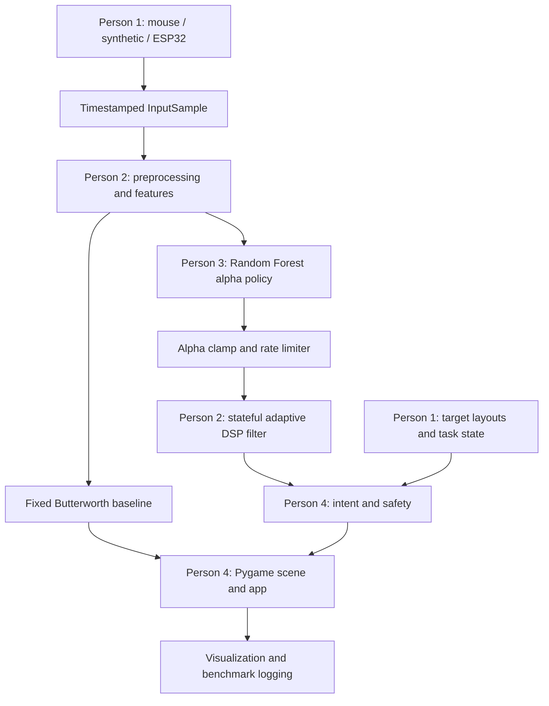

# IntentGlide — System Architecture

## Current baseline

The current code path is primarily synthetic input → motion analysis → fixed/rule-based adaptive filters → target-intent logic → Pygame display. The main app currently instantiates `SyntheticInputGenerator`; the Pygame mouse adapter exists but is not wired into the main loop. The ESP32 sketch is starter firmware; host serial integration is not yet complete.

## Planned ML-guided path



## Module boundaries

- **P1:** generates input samples, ground truth, disturbance metadata, target geometry and task scenarios. P1 does not render the scene.
- **P2:** owns timestamp-aware preprocessing, signal features, Butterworth baseline and heuristic/adaptive DSP filter.
- **P3:** owns dataset assembly, optimal-alpha labels, Random Forest training, model persistence and inference fallback.
- **P4:** owns Pygame rendering, orchestration, target-intent logic, safety, diagnostics and whole-system evaluation.

## ML policy contract

Proposed interface:

```python
alpha_target = filter_policy.predict_alpha(motion_features)
filtered = adaptive_filter.update(sample, alpha_target=alpha_target)
```

This is not implemented in the current baseline. The existing filter currently calculates alpha from a heuristic formula. ML inference should return a finite target alpha; the filter or policy wrapper must clamp and rate-limit it. Missing/broken model artifacts must trigger a visible heuristic fallback.

## Timing and safety

- Preserve monotonic event timestamps.
- Never assume real mouse input is uniformly sampled.
- Explicitly resample to a uniform grid if using algorithms that require it.
- Keep filter state across samples and reset between trials.
- Keep processing time separate from end-to-end latency.
- Bound and expose assistance; abstain when intent is ambiguous; always permit override.

## Evaluation

Compare raw, fixed Butterworth, heuristic adaptive and ML adaptive modes on identical paths. Measure tracking error, residual high-frequency energy, lag, target task outcomes, false assistance, inference time and end-to-end latency. Synthetic, motor-generated, and real-user evidence must be reported separately.
